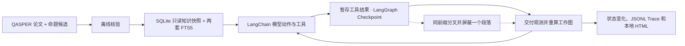

# Research Agent MVP

围绕 QASPER 的一篇真实论文《The Evolved Transformer》，复现单篇问答、证据依赖与同一检查点的观测干预。问题是自拟的，构建语料时只投影论文内容。论文版本、许可和原始语料指纹见 [fixtures/SOURCE.md](fixtures/SOURCE.md)。

## 本地复现

在项目根目录执行：

```bash
python3 -m venv .venv
.venv/bin/python -m pip install -e '.[dev]'
.venv/bin/python scripts/prepare_qasper_fixture.py
.venv/bin/python -m pytest -q
.venv/bin/python -m research_agent.cli --model mock --output runs/mock-demo
```

准备脚本通过 Hugging Face Dataset Viewer 获取一条 QASPER 论文记录，校验内容哈希和原文锚点，再生成 Git 忽略的 `fixtures/qasper_paper.json`。已有匹配的 Dataset Viewer JSON 导出时，运行 `python3 scripts/prepare_qasper_fixture.py --rows-json YOUR_EXPORT.json` 即可离线生成同一份 fixture。

命令要求全新的输出目录。运行结束后用浏览器打开 `runs/mock-demo/report.html`，切换原始、对照和屏蔽分支。独立 HTML 内包含依赖图、按步事件和原文段落索引。

## GPT-6.2-sol 子 Agent 运行

```bash
.venv/bin/python -m research_agent.cli --model exchange --mask-paragraph s11p5 --output runs/sol-demo
```

`--model exchange` 通过本地文件交接模型调用。运行时按顺序在 `exchange/slot-1`、`slot-2`、`slot-3` 写出 `request-NNN.json`。分别交给独立子 Agent，只提供该槽的请求文件。子 Agent 根据其中的原始工具消息与工具契约写同编号 `response-NNN.json`，用临时文件加同目录原子重命名提交。

```json
{
  "name": "search",
  "arguments": {"query": "machine translation ablation validation perplexity"},
  "action_reason": "寻找支撑归因判断的实验对照。",
  "source_ids": [],
  "requirements": [{"id": "mutation-effect", "question": "Which individual mutations can the experiments attribute gains to?"}]
}
```

首次动作必须从用户问题生成 `requirements`。后续可通过 `claim_assessments` 更新某项要求的结论、支持状态、判断理由和已读段落的逐字引文。请求附带完整的 `response_schema`。省略 `--mask-paragraph` 时只运行原始问答。`estimated_tokens` 是本地对消息和动作的统一估算，子 Agent 的整个会话用量不在该数字里。

## 数据流



- `fixtures/qasper_offline_review.json` 保存 GPT-6.2-sol 对 8 条预抽取候选的语义核验，以及判断范围、证据段落与命题内容哈希。同一核验者、同一范围的新版本会替换旧判断。独立核验同时存在支持和反驳时，工作图记录 `CONFLICTED` 及各自来源。
- `store.py` 负责 Alembic 迁移、快照和索引。快照使用各自的 FTS5 索引和 BM25 统计。迁移保留旧核验记录，缺少版本绑定的记录需要重新核验才能参与图状态计算。检索模式仍为 `--retrieval paragraph|unit|dependency`。
- `runtime.py` 记录内容首次进入模型上下文的时间和来源（`InformationExposure`）。段落模式在读取原文时暴露内容，Unit 和 Dependency 模式也可能在搜索阶段暴露命题及引文。两条重放从首次暴露前的同一检查点恢复。干预修改一次工具观测，同批其他证据保留，后续允许正常补查。无合法分叉点时记录 `INTERVENTION_NOT_APPLICABLE` 并保留原始轨迹和报告。
- `working.py` 将已获取的相关证据（Evidence Coverage）和证据对具体结论的语义支持（Claim Support）作为独立状态。运行报告的 Answer Correctness 保持 `NOT_EVALUATED`，由独立 Evaluation 判分。预设命题 ID 和答案只供 Mock 使用。

每次运行生成两份 SQLite、`knowledge_snapshot.json`、实际执行的各分支 JSON 和 JSONL、`experiment.json` 与 `report.html`。当前演示范围是一篇论文。

## 首次真实模型运行结果

GPT-6.2-sol 完成了离线候选核验、原始问答以及两个重放分支。对照组和干预组共享同一检查点，干预只屏蔽一条消融段落。屏蔽后归因 Requirement 从 `SUPPORTED` 降为 `UNKNOWN`。两项数值结果的独立证据仍可见，模型转去补查消融后，遗漏了完整数值比较所需的实验范围。本次结果验证的是单题干预机制。
