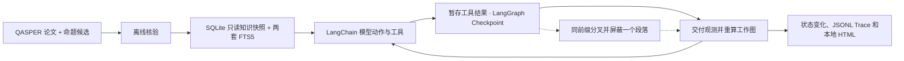

# Research Agent MVP

围绕 QASPER 的一篇真实论文《The Evolved Transformer》，复现单篇问答、证据依赖与同一检查点的观测干预。问题是自拟的，构建语料时只投影论文内容。论文版本、许可和原始语料指纹见 [fixtures/SOURCE.md](fixtures/SOURCE.md)。

## 本地复现

在项目根目录执行：

```bash
python3 -m venv .venv
.venv/bin/python -m pip install -e '.[dev]'
.venv/bin/python scripts/prepare_qasper_fixture.py
.venv/bin/python -m pytest -q
.venv/bin/python -m research_agent.cli --model mock --output runs/mock-demo
```

准备脚本通过 Hugging Face Dataset Viewer 获取一条 QASPER 论文记录，校验内容哈希和原文锚点，再生成 Git 忽略的 `fixtures/qasper_paper.json`。已有匹配的 Dataset Viewer JSON 导出时，运行 `python3 scripts/prepare_qasper_fixture.py --rows-json YOUR_EXPORT.json` 即可离线生成同一份 fixture。

命令要求全新的输出目录。运行结束后用浏览器打开 `runs/mock-demo/report.html`，切换原始、对照和屏蔽分支。独立 HTML 内包含依赖图、按步事件和原文段落索引。

## GPT-6.2-sol 子 Agent 运行

```bash
.venv/bin/python -m research_agent.cli --model exchange --output runs/sol-demo
```

`--model exchange` 通过本地文件交接模型调用。运行时按顺序在 `exchange/slot-1`、`slot-2`、`slot-3` 写出 `request-NNN.json`。分别交给独立子 Agent，只提供该槽的请求文件。子 Agent 根据其中的原始工具消息与工具契约写同编号 `response-NNN.json`，用临时文件加同目录原子重命名提交。

```json
{
  "name": "search",
  "arguments": {"query": "machine translation ablation validation perplexity"},
  "action_reason": "寻找支撑归因判断的实验对照。",
  "source_ids": []
}
```

这条路径通过 LangChain 工具与消息对象执行模型所选动作。模型响应由 Codex 子 Agent 提交。`estimated_tokens` 是本地对消息和动作的统一估算，子 Agent 的整个会话用量不在该数字里。

## 数据流



- `fixtures/qasper_offline_review.json` 是 GPT-6.2-sol 对 8 条预抽取候选的独立语义核验。核验使用论文原文与命题候选，应用保存模型的判断范围和证据段落。命题候选的来源与验证见 `fixtures/SOURCE.md`。
- `store.py` 负责 Alembic 迁移、快照和索引。运行时可选同一个入口下的 `--retrieval paragraph|unit|dependency`，依赖模式按类型化边扩展一跳。原始问答实验用段落模式，让消融全文只在 `read` 时交付。
- `runtime.py` 将动作选择、工具执行和观测交付拆成单独的 LangGraph 节点。重放检查消息、工作图、已交付观测、动作、预算和事件前缀的一致性。对照沿用工具原响应，干预从同一批原文中屏蔽 `s11p5`，其他同批段落保持原样。
- `working.py` 只用当前分支已读到的锚点更新证据图。作者陈述、可复用的离线核验和本次回答要求各有记录。沿控制组和干预组依赖边的并集追查受影响项。图状态衡量演示定义的来源覆盖，最终回答质量需另行核对原文与完整性。

每次运行生成两份 SQLite、`knowledge_snapshot.json`、三份分支 JSON 和 JSONL、`experiment.json` 与 `report.html`。项目测试验证 FTS 检索、幂等发布、事务回滚、检查点前缀、同批非目标证据保存、替代锚点与归因状态变化。当前范围是一篇论文的一条演示题。

## 首次真实模型运行结果

GPT-6.2-sol 完成了离线候选核验、原始问答以及两个重放分支。对照组和干预组共享同一检查点，干预只屏蔽一条消融段落。屏蔽后归因 Requirement 从 `SUPPORTED` 降为 `UNKNOWN`。两项数值结果的独立证据仍可见，模型转去补查消融后，遗漏了完整数值比较所需的实验范围。本次结果验证的是单题干预机制。
